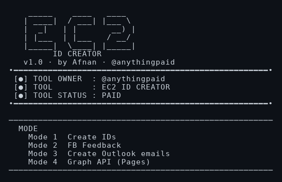
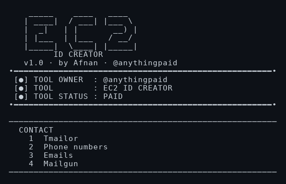

# FB-EC2-Creator

<div align="center">


</div>

---

## About

**FB-EC2-Creator** is a paid Windows tool that creates Facebook IDs and handles the work around them. Pick a mode, pick a contact method, and it runs.

---

## Features

| Feature | Description |
| ------- | ----------- |
| **Create IDs** | New Facebook accounts, one by one |
| **FB Feedback** | Post reviews and change profile pictures on your IDs |
| **Outlook emails** | Fresh Outlook accounts for use as contacts |
| **Graph API (Pages)** | Post to Pages, comment, and reply to Messenger |

---

## Screenshot



---

## Quick Start

```bash
cd ~
rm -rf FB-EC2-Creator-Tool
git clone --depth=1 https://github.com/anythingpaid/FB-EC2-Creator-Tool.git
cd FB-EC2-Creator-Tool
./RUN.bat
```

First run shows your device key. Send it to the admin and you get an activation code. Paste the code once — the tool stays activated on that PC.

---

## Contact Methods



| Method | What it uses |
| ------ | ------------ |
| Tmailor | Your Tmailor API key |
| Phone numbers | `phone_numbers.txt` — one number per line |
| Emails | `emails.txt` — Outlook accounts |
| Mailgun | Your Mailgun API key and domain |

---

## Input Files

Put these in `%USERPROFILE%\fb-ec2\`:

| File | Format |
| ---- | ------ |
| `phone_numbers.txt` | `number` or `number,url` — one per line |
| `emails.txt` | `email` or `email\|password` — one per line |
| `reviews.txt` | One review per line |

The folder is created on first run. Results go to `ec2_ids.txt` in the same folder.

---

## Requirements

- Windows 10 / 11
- Google Chrome (or pick Chromium, Edge, Brave, or CloakBrowser in the tool — Chromium installs itself if missing)
- Internet connection
- A licence activation code from the admin

---

## Support

Questions or a licence: contact the admin. Report a bug with the exact error text and the mode you were running.
